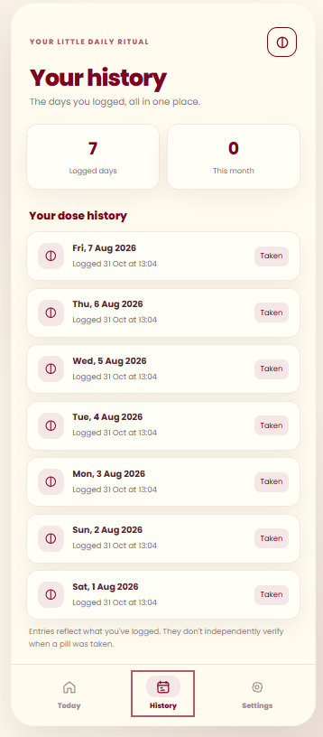
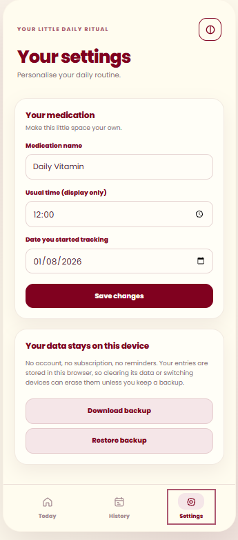

<div align="center">


# Pill Diary

**A minimalist, iOS-inspired pill tracking web app.**

A personal project designed to make it simple to log medication, review previous days, and keep a private record — without subscriptions, accounts, or notification prompts.

[**View Live App**](https://pill-diary-app.pages.dev) · [**Browse Source Code**](pill-diary-ivory-burgundy/index.html)

</div>

## Overview

Pill Diary is a responsive, installable progressive web app (PWA) with a custom ivory-and-burgundy interface. It was designed around a simple interaction: tap an outlined pill icon to record a dose. Faded icons indicate that no dose has been logged, while fully opaque icons indicate a logged dose.

The design uses rounded-square calendar dates, subtle card shadows, Poppins typography, and mobile-friendly navigation.

## App preview

The screenshots below show the Today dashboard, medication history, and settings.

<p align="center">
  
  
  
</p>

## Features

- **Interactive calendar:** View and update medication logs for eligible past dates and today.
- **One-tap logging:** Tap the vertical-line pill icon to log a dose; tap it again to undo.
- **Medication history:** Review dates logged and when each entry was recorded.
- **Customisable settings:** Edit the medication name, usual time displayed, and tracking start date.
- **Local data storage:** Records are saved in the browser using `localStorage`.
- **Backup and restore:** Export records to JSON and import them on another device.
- **Installable web app:** Add Pill Diary to an iPhone Home Screen from Safari.
- **Responsive layout:** A compact app-style presentation on mobile and desktop.
- **Basic offline support:** A service worker caches core app files after the first successful load.

## Tech stack

| Technology | How it's used |
| --- | --- |
| HTML5 | App structure and accessible controls |
| CSS3 | Responsive layout, custom colour palette, and visual states |
| Vanilla JavaScript | Calendar, navigation, pill logging, settings, and history |
| Browser `localStorage` | Local persistence of medication records |
| Web App Manifest & Service Worker | Home Screen installation and asset caching |
| Google Fonts (Poppins) | Typography |
| Cloudflare Pages | Live deployment |

## Run locally

There is no build step, dependency installation, or paid software required.

1. Clone or download this repository.
2. Open the `pill-diary-ivory-burgundy` folder in VS Code.
3. Open `index.html` in a browser to preview it.

For full service-worker behaviour, serve the project locally, for example:

```bash
cd pill-diary-ivory-burgundy
python -m http.server 8000
```

Then visit [http://localhost:8000](http://localhost:8000).

## Project structure

```text
pill-diary/
├── README.md
├── Screenshot 2026-10-31 130353.png
├── history.png
├── Settings.png
└── pill-diary-ivory-burgundy/
    ├── index.html
    ├── manifest.webmanifest
    ├── sw.js
    ├── icon-192.png
    ├── icon-512.png
    ├── apple-touch-icon.png
    └── README.md
```

## Design

The colour palette is based on ivory cream (`#FFFCEF`) and burgundy (`#80011F`), with softer shades for cards and active states. Custom SVGs make the pill and decorative star icons consistent across desktop and iPhone.

## Privacy and limitations

Pill Diary does not require an account and does not automatically sync data between devices. Medication names, tracking dates, and logs are stored **locally in the browser**. Clearing site data or deleting an installed app may remove those records, so users should regularly export backups.

There are **no medication reminders or push notifications**. The app records what a user chooses to log; it cannot verify whether or when medication was actually taken. The usual-time field is for display only. It is a personal tracking tool, **not medical advice or a clinical reminder system**.

The Poppins font loads from Google Fonts when online; a fallback font may appear offline.

## Possible future improvements

- Optional support for multiple medications
- More detailed history filters and summaries
- Improved backup prompts and storage resilience
- Accessibility and cross-browser testing

---

<div align="center">
Made as a personal web-development and UI/UX portfolio project.

[**Try Pill Diary**](https://pill-diary-app.pages.dev)
</div>
